# AI Bug Analyser

A Next.js App Router app for running and reviewing C++ code. The home page uses Monaco and the existing dark theme. Credentials are checked with bcrypt through NextAuth; JWT sessions carry the signed-in user's ID. Drizzle reads and writes PostgreSQL. The Analytics page groups that user's saved analysis reports by bug category and displays them with Recharts.

- `/api/auth/[...nextauth]` handles NextAuth; `/api/auth/register` creates a user.
- `/api/analyze` streams Gemini 2.5 Flash's tutoring response. Next.js `after()` runs the category extraction after streaming, and PostgreSQL saves the resulting rows in one insert. If Gemini or the database fails during extraction, the analysis can still display and the server logs the write failure.
- `/api/execute` runs C++ through the configured hosted sandbox. It does not store execution results or run a local compiler.
- `db/schema.ts` and `db/migrations/` define users, accounts, sessions, verification tokens, and bug reports. This feature adds no tables or migrations.

## Local setup

1. Use Node.js 22.18 or later (the test scripts use Node's built-in TypeScript support). Run `npm ci`.
2. Copy `.env.example` to `.env.local`. Configure `DATABASE_URL` for your PostgreSQL database, `NEXTAUTH_URL=http://localhost:3000`, and a strong random `NEXTAUTH_SECRET`. Set `GEMINI_API_KEY` for AI analysis.
3. For a **new development database**, check the connection points to the intended database and apply the checked-in migration with `npx drizzle-kit migrate`. An already initialized database with this schema needs no change for this feature.
4. Set `JDOODLE_CLIENT_ID` and `JDOODLE_CLIENT_SECRET` in `.env.local` from your JDoodle Compiler API dashboard. The server uses the official [JDoodle REST API](https://www.jdoodle.com/docs/api/rest) and pins [C++17, GCC 15.2.1](https://www.jdoodle.com/docs/api/languages) as `cpp17` with `versionIndex: "3"`.
5. Run `npm run dev`, open `http://localhost:3000`, register, and sign in. Open **Test Cases** to set stdin and optionally check an expected output. Select the case to run, then click **Run Code**. Select another case to run it separately. **Analyze with AI** can use recorded results. Refresh Analytics after a completed analysis to see saved categories.

The same variables are server-only Vercel project settings if you deploy; set `NEXTAUTH_URL` to the applicable deployment origin. The execution and analysis routes declare 35-second and 60-second function durations. Google fonts are downloaded at build time, and Monaco loads its assets through the existing editor integration.

## Execution flow

```mermaid
flowchart LR
    A["Monaco and test cases"] --> B["POST /api/execute"]
    B --> C["Check session, inputs and run limit"]
    C --> D["JDoodle: one REST call for the selected case"]
    D --> F["Read program outcome, compare output, sign evidence"]
    F --> G["Show output, errors and verdicts"]
    G --> H["POST /api/analyze with matching evidence"]
    H --> I["Verify evidence and stream Gemini review"]
    I --> J["Extract categories and save analytics"]
```



The route accepts `{ code, testCases: [{ input, expectedOutput }], caseIndex, evidence }`. A run with no cases uses empty stdin. The server sends source and stdin to JDoodle in one request. There are no automatic runs, polls, or retries. JDoodle's API status describes the request. The app uses its program flags and timeout diagnostic to classify the result. If JDoodle omits the program outcome, the result is unchecked.

The comparison uses JDoodle's full returned output before shortening the display. It normalizes CRLF to LF and preserves all other characters. JDoodle can combine stdout and stderr and can omit the final newline, so enter the expected output as JDoodle returns it. A checked blank expectation requires empty returned output. A missing expectation remains unchecked. Editing code or tests hides old results. Signed results are bound to the user and exact code and tests for 30 minutes. Gemini receives excerpts of the cases already run.

The [Free API plan](https://www.jdoodle.com/docs/api/credits) has 20 daily credits. A click runs one case and can use one credit, including a compile or runtime failure. Four custom cases, 32 KiB of source, 8 KiB per input or expectation, and 4,096 displayed output characters are allowed. The server allows one in-flight run per user per process, with at least five seconds between starts. JDoodle enforces its daily quota and sandbox limits. A 25-second wait limit on this app's provider request can expire before the provider returns. A provider timeout and a program timeout are shown separately.

## Verification

```bash
npm run lint
npx tsc --noEmit
npm run build
npm test
```

`npm test` uses mocked JDoodle responses and consumes zero credits. Run `npm run test:live` explicitly for one real C++ stdin/output check, which can use one credit. It skips if the JDoodle credentials are missing. Registration, Gemini streaming, and analytics need a configured database and Gemini key for an end-to-end smoke test.
