# AI Bug Analyser

A Next.js App Router app for running and reviewing C++ code. The home page uses Monaco and the existing dark theme. Credentials are checked with bcrypt through NextAuth; JWT sessions carry the signed-in user's ID. Drizzle reads and writes PostgreSQL. The Analytics page groups that user's saved analysis reports by bug category and displays them with Recharts.

- `/api/auth/[...nextauth]` handles NextAuth; `/api/auth/register` creates a user.
- `/api/analyze` streams Gemini 2.5 Flash's tutoring response. Next.js `after()` runs the category extraction after streaming, and PostgreSQL saves the resulting rows in one insert. If Gemini or the database fails during extraction, the analysis can still display and the server logs the write failure.
- `/api/execute` runs C++ through the configured hosted sandbox. It does not store execution results or run a local compiler.
- `db/schema.ts` and `db/migrations/` define users, accounts, sessions, verification tokens, and bug reports. This feature adds no tables or migrations.

## Local setup

1. Use Node.js 22.18 or later (the test scripts use Node's built-in TypeScript support). Run `npm ci`.
2. Copy `.env.example` to `.env.local`. Configure `DATABASE_URL` for your PostgreSQL database, `NEXTAUTH_URL=http://localhost:3000`, and a strong random `NEXTAUTH_SECRET`. Set `GEMINI_API_KEY` for AI analysis.
3. For a **new development database**, check the connection points to the intended database and apply the checked-in migration with `npx drizzle-kit migrate`. An already initialized database with this schema needs no change for this feature.
4. Set `JUDGE0_URL` to the HTTPS base URL of a trusted, patched [Judge0-compatible sandbox](https://ce.judge0.com/). Set `JUDGE0_AUTH_TOKEN` for a native `X-Auth-Token` credential or `JUDGE0_API_KEY` for RapidAPI (the host header is derived from the configured URL). Use the provider's active `/languages` list to optionally set `JUDGE0_CPP_NAME` to an exact C++ compiler name; otherwise the app uses the first active C++ entry.
5. The provider must accept the per-job CPU, wall, memory, file, and network settings sent by this app. Confirm program network access is disabled on the provider for your integration, and set a provider-side quota. Source and stdin are sent to the provider, so check its retention and access policy.
6. Run `npm run dev`, open `http://localhost:3000`, register an account, and sign in. Open **Test Cases** to set stdin and opt into an expected-output check. Use **Run Code**, then **Analyze with AI**. Refresh Analytics after a completed analysis to see saved categories.

The same variables are server-only Vercel project settings if you deploy; set `NEXTAUTH_URL` to the applicable deployment origin. The execution and analysis routes declare 35-second and 60-second function durations. Google fonts are downloaded at build time, and Monaco loads its assets through the existing editor integration.

## Execution flow

```mermaid
flowchart LR
    A["Monaco and test cases"] --> B["POST /api/execute"]
    B --> C["Check session, inputs and run limit"]
    C --> D["Judge0: discover C++ and submit jobs"]
    D --> E["Next.js polls until terminal status"]
    E --> F["Compare stdout and sign evidence"]
    F --> G["Show output, errors and verdicts"]
    G --> H["POST /api/analyze with matching evidence"]
    H --> I["Verify evidence and stream Gemini review"]
    I --> J["Extract categories and save analytics"]
```



The Run endpoint accepts `{ code, testCases: [{ input, expectedOutput }] }`. With no test cases, it runs once with empty stdin and no expectation. The sandbox receives Base64 source and stdin; submission tokens and credentials stay on the server. The sandbox runs the cases in independent jobs; the app keeps their original order. A sandbox timeout is distinct from a network or polling timeout. Run evidence is signed, tied to the user and exact code/tests, and expires after 30 minutes. Editing code or tests hides stale results. Gemini receives short output excerpts and is instructed to label predictions separately from observations.

**Output policy:** the check compares stdout only. CRLF becomes LF; all other characters count, including leading and trailing spaces, tabs, and the final newline. A missing expectation is represented by `null` and shows as **not checked**. A checked blank expectation requires genuinely empty stdout. Failed compilation, runtime failures, and execution timeouts fail checked cases. Provider errors leave cases unchecked. Invalid UTF-8 output cannot match a text expectation. Comparison uses full returned stdout before display truncation.

**Limits:** 32 KiB source, four test cases, 8 KiB per input and expected output, 2 seconds of CPU time and 5 seconds of wall time per execution job, and 4 KiB of displayed data per output stream. Provider calls have a 5-second timeout each; the whole submission/poll phase has a 25-second deadline. The in-memory cooldown allows one run per user per 25 seconds per process. It resets on a cold start and is not a global quota across Vercel instances. If polling stops, a submitted job may still finish under the provider's limits.

## Verification

```bash
npm run lint
npx tsc --noEmit
npm run build
npm test
npm run test:live
```

`npm test` checks request handling, comparison, limits, status mapping, the HTTP contract, and signed evidence using local test inputs and a simulated provider transport. `npm run test:live` sends six small C++ submissions to the configured provider, covering stdin/stdout, multiple cases, empty output, compile failure, nonzero exit, and timeout. It skips when `JUDGE0_URL` is unset. A browser smoke test also requires a real database and Gemini key to exercise registration, login, AI streaming, and analytics.
