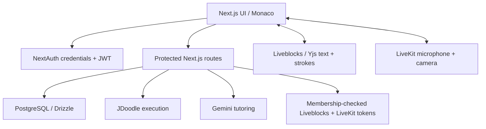

# AI Bug Analyser

A C++ debugging workspace for students and pairs of developers. Run a small program, inspect its actual output, and ask Gemini for guided explanations. Two people can work on the same code and drawing board while using an audio/video call.

## Features

- Monaco C++ editor with manual JDoodle execution, stdin, and optional expected-output checks.
- Structured Gemini bug reports on the home page, using signed execution evidence when available.
- Private two-account rooms with owner-approved admission, shared Monaco/Yjs editing, remote selections, and a shared whiteboard.
- Camera-off and microphone-off call joining, optional camera and microphone controls, participant placeholders, and collapsible video tiles.
- Shared room execution and analysis records, fixed code/test snapshots, stale-result notices, and Markdown session reports.
- PostgreSQL-backed analytics with code filtering, completed analysis counts, execution outcomes, and recent rooms.
- Responsive dark interface.

## Stack and architecture

Next.js App Router, React, TypeScript, NextAuth credentials/JWT sessions, PostgreSQL, Drizzle, Monaco, Gemini, JDoodle, Liveblocks/Yjs, and LiveKit.



PostgreSQL stores account records, rooms, join requests, action snapshots, results, and bug categories. Liveblocks persists collaborative text and drawings. LiveKit transports audio/video tracks.

## Local setup

1. Install Node.js 22.18 or newer and run `npm ci`.
2. Copy `.env.example` to `.env.local` and fill in server variables.
3. Point `DATABASE_URL` at your development PostgreSQL database and run `npx drizzle-kit migrate`. Existing accounts and reports are preserved by the additive migrations. A database created outside the migration workflow may need its existing schema baselined before applying migrations.
4. Run `npm run dev` and open `http://localhost:3000`.
5. Register two accounts in separate browser profiles. Create a room, share its invite, request access from the second account, then admit it from the owner account.

### Environment

| Variable | Purpose |
| --- | --- |
| `DATABASE_URL` | PostgreSQL connection |
| `NEXTAUTH_URL` | App origin, such as `http://localhost:3000` |
| `NEXTAUTH_SECRET` | Random session and execution-evidence signing secret |
| `GEMINI_API_KEY` | Google AI Studio key for tutoring and category extraction |
| `JDOODLE_CLIENT_ID` / `JDOODLE_CLIENT_SECRET` | Compiler API credentials |
| `LIVEBLOCKS_SECRET_KEY` | Private room provisioning and scoped authorization |
| `LIVEKIT_URL` | LiveKit WebSocket URL |
| `LIVEKIT_API_KEY` / `LIVEKIT_API_SECRET` | Server-side call token signing |

The frontend receives scoped participant tokens. Keep provider credentials in the server environment.

## Authentication and room admission

NextAuth verifies a bcrypt password against PostgreSQL and issues a JWT carrying the user's ID. A room has an unpredictable UUID, a separate unpredictable invitation code, an owner, and one optional admitted account. The invitation creates a join request. It grants no editor or call permission until the owner admits that account.

Admission uses an atomic conditional database update, so concurrent attempts cannot fill the second slot twice. Multiple tabs use the same account ID. Protected room operations recheck the authenticated account against the owner/admitted participant. Liveblocks access tokens are scoped to that room. LiveKit grants join/subscribe and only microphone/camera publishing for the same account identity and room name, with a two-participant room configuration. A second call connection from the same account can replace its earlier connection.

## Main routes

| Route | Behavior |
| --- | --- |
| `/api/auth/[...nextauth]` | Sign-in and session |
| `POST /api/auth/register` | Validated account creation |
| `POST /api/execute` | Authenticated single-case JDoodle run and durable outcome |
| `POST /api/analyze` | Generate a validated bug report and persist it |
| `POST /api/liveblocks-auth` | Room-scoped collaboration token |
| `POST /api/voice-token` | Room-scoped microphone/camera token |
| `GET /api/rooms/[id]/activities` | Authorized room history |
| `POST /api/rooms/[id]/activities` | Reserve and perform a shared execution, analysis, or report |
| `/collaborate` | Create rooms and request admission |
| `/analytics` | Stored activity counts and code-specific categories |

Room creation and admission use authenticated Next.js server actions.

## Execution and shared results

JDoodle is called once per selected run, only after a click. The server pins `cpp17` and `versionIndex: "3"`, documented as GCC 15.2.1 in the [JDoodle language table](https://www.jdoodle.com/docs/api/languages). The [Free API tier](https://www.jdoodle.com/docs/api/credits) has 20 daily credits. Failed program runs can also consume a credit. The app performs no automatic execution retries.

A request's HTTP/API status differs from the program outcome. The adapter inspects `isCompiled`, `isExecutionSuccess`, and the observed JDoodle timeout diagnostic. Missing program outcome fields remain unknown.

Comparison normalizes CRLF to LF and preserves all other returned characters. JDoodle may combine stderr with stdout and omit the final newline. A checked blank expectation requires empty returned output. The comparison uses full returned output before display truncation.

Source is capped at 32 KiB, inputs/expectations at 8 KiB, and displayed output at 4,096 characters. Home supports four cases run individually. A room action runs one submitted case and stores its input/expectation alongside the result. A 25-second provider wait limit does not terminate a remote job.

Each room action has a UUID. A PostgreSQL transaction locks the room row, rejects a concurrent active action, and reserves a durable activity before contacting a provider. Reusing a request UUID returns the original row. Different UUIDs are rate limited. This works across application instances. Unknown/interrupted actions are marked after two minutes on history refresh and are never executed automatically.

Room history refreshes every 2.5 seconds. Both users see the same ID, result, input, and source. Code edited during a run stays editable, and results display a stale-snapshot warning. The browser can lose a response while the server completes the action, so check history before intentionally submitting another run.

## Realtime editor, board, and calls

`RoomWorkspace` owns a Liveblocks room. `SharedEditor` reuses `CodeEditor`, binds Monaco with the official Yjs integration, and waits for synchronization before editing. The provider is managed by Liveblocks and the Monaco binding is detached on unmount.

The whiteboard uses a Yjs array of normalized strokes in the same document. It previews locally, samples pointer movement, and publishes a completed stroke on release. Other users see completed strokes. Erasing is a shared erase stroke. Clear asks for confirmation. A remote stroke still being drawn can appear after clear. The board allows 500 strokes and 512 points per stroke.

`CallPanel → LiveKitRoom → CallControls` uses the official LiveKit React components. `VideoTrack` displays subscribed camera publications, `TrackToggle` manages devices, and `RoomAudioRenderer` attaches remote audio. Users join with both devices off. Permission failures leave listening and other features available. Leaving/unmounting disconnects the room and releases media. Video tiles collapse on phones while controls remain accessible. Camera and microphone require HTTPS outside localhost.

## Gemini and persistence

The home route generates a structured C++ tutoring report. It validates signed execution evidence against the user and exact input. The room route uses stored execution results matching the code and tests as server evidence, then saves a single shared completed analysis. Viewing or polling a room never calls Gemini.

Gemini returns JSON with critical/high/medium/low findings. The server validates fields and source ranges and only enables line navigation when the quoted source matches the actual lines. Language, severity counts, code snippets and execution observations are computed from validated source and server evidence. The full report appears after generation and validation; the UI shows a loading state while waiting. It does not stream partial bug cards.

The report, Markdown representation and its validated bug categories are persisted in one transaction. There is one Gemini request per analysis, and no second AI category-extraction request. Analytics counts completed analysis records rather than treating every bug row as a separate analysis. Legacy category-only rows remain visible but cannot provide a trustworthy historical analysis count.

The category chart counts recorded occurrences across analyses, excluding the clean-code marker. Program completion metrics are distinct from test pass/fail verdicts.

## Session reports

Generate a report from the final source and up to 50 recent room records. The first available action supplies the initial recorded source, not the first keystroke. Reports include observed outcomes, AI hypotheses when recorded, source snapshots, and test inputs/expectations. Missing evidence is labeled. A changed source is not automatically called a fix. Reports use deterministic Markdown assembly and consume no AI/compilation credits. Copy or download the Markdown from the result panel.

## Verification

```sh
npm run lint
npx tsc --noEmit
npm test
npm run build
```

`npm test` covers execution validation, comparison, JDoodle normalization, evidence binding, room IDs, and report honesty using local fixtures.

`TEST_DATABASE_URL=... npm run test:rooms` uses a migrated test PostgreSQL database to verify atomic room admission, membership, cross-room isolation, concurrent request idempotency, and room-action exclusion. The test creates and removes only its own generated accounts and cascading records. It skips when the test URL is absent. Use your shell's environment-variable syntax.

`npm run test:live` is an explicit one-credit JDoodle test. It is separate from the default suite.

Run `npm run test:browser` with `TEST_DATABASE_URL`, a running local app, configured providers, and Chrome installed. `ROOM_TEST_ORIGIN` selects the local test app and `CHROME_PATH` overrides the browser executable. This explicit suite creates separate local test accounts and consumes execution/Gemini credits. It covers live editing, drawing, video/audio, shared execution, reports, analysis persistence, and line navigation.

Use `npm run test:browser -- --collaboration-only` to check collaboration and media without compiler or Gemini calls. `npm run test:browser:home` separately checks real home-page compilation and analysis and consumes one compiler credit.

### Two-browser demonstration

1. Sign in as two accounts, create a room, request and admit the second account.
2. Edit from both sides simultaneously, reload one side, and check convergence.
3. Draw and erase from both accounts, resize, reload, then clear.
4. Join the call with both devices off. Enable microphones and cameras, switch either off, leave, and rejoin.
5. Deny device permission and check the error plus continued listening/editing.
6. Attempt the room page, action API, and token APIs as a third account and confirm rejection.
7. Run a small C++ program. Check shared IDs/output, edit its source, and check the stale warning.
8. Analyze the code with a configured Gemini key. Check its stored result in both browsers and Analytics.
9. Generate, copy, and download a Markdown report.

Browser automation with separate registered accounts and simulated devices was used during development. Physical device and human audio/video quality testing require two real devices. The automated browser suite uses simulated capture devices with real provider transport.

## Deployment to Vercel

1. Configure the server variables above in the Vercel project's Production environment. Set `NEXTAUTH_URL` to its production origin.
2. Back up the production database and apply the additive migrations with `npx drizzle-kit migrate` using the production connection. Check migration history first if the initial schema was created manually. Never reset existing tables.
3. Push the tested branch, review its preview, and merge it into the configured production branch.
The production build checks that the room/activity migrations exist and fails before replacing the previous deployment when they are missing.

4. Verify registration, authentication, analytics, room authorization, and provider connectivity in the resulting deployment.

A successful frontend build does not verify production database migrations, provider credentials, or media connectivity. Liveblocks/LiveKit project keys must belong to the intended project, and the LiveKit URL must match its API key.

## Technical decisions and limits

- A room row with one participant slot makes the two-account rule easy to inspect and enforce atomically.
- PostgreSQL row locks and durable request IDs coordinate provider work without another backend.
- Yjs handles concurrent edits. PostgreSQL stores deliberate snapshots instead of keystrokes.
- LiveKit React components handle tracks and device state with official cleanup behavior.
- Results are bounded, and source remains plaintext for debugging. Treat rooms and invitation codes as sensitive.
- Tokens expire, but a connected provider session may remain live until disconnected. Membership removal/room closing is not exposed in this version.
- Provider failures, missing credentials, model mistakes, and output truncation are visible limitations.
- Quotas must also be configured with the providers. A room cooldown does not impose a global per-day product budget.
